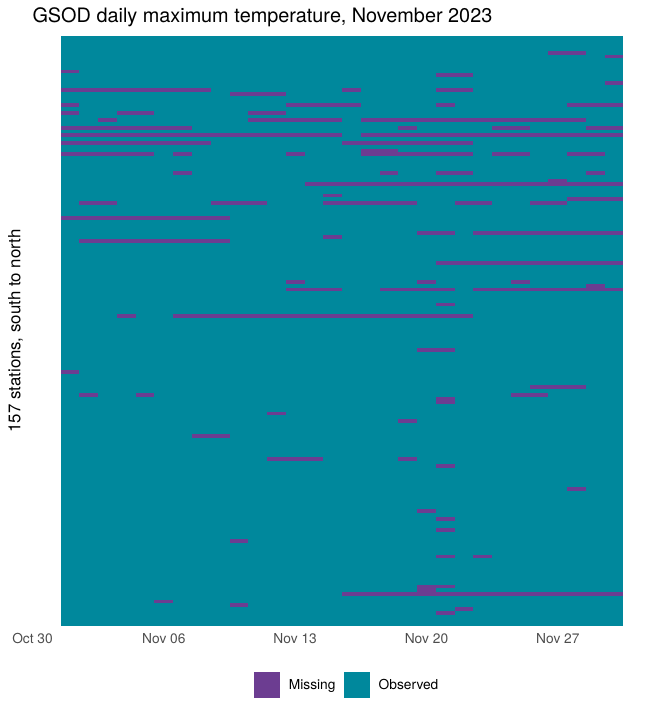
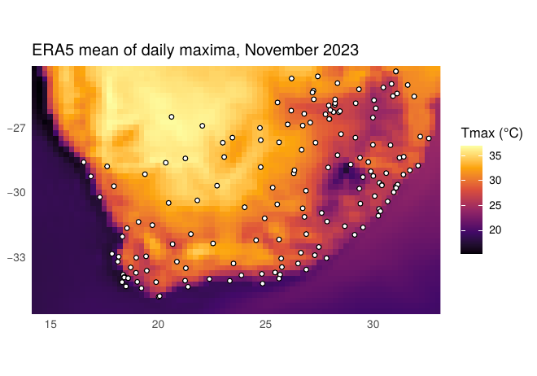
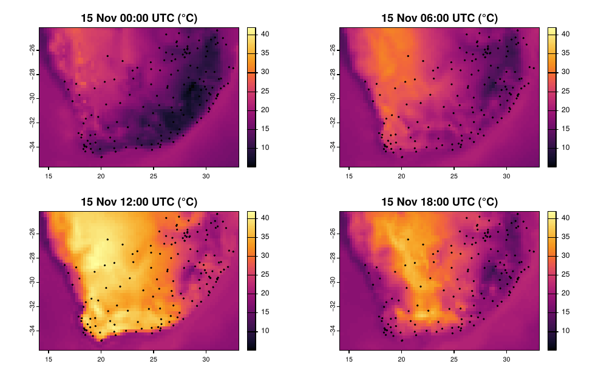
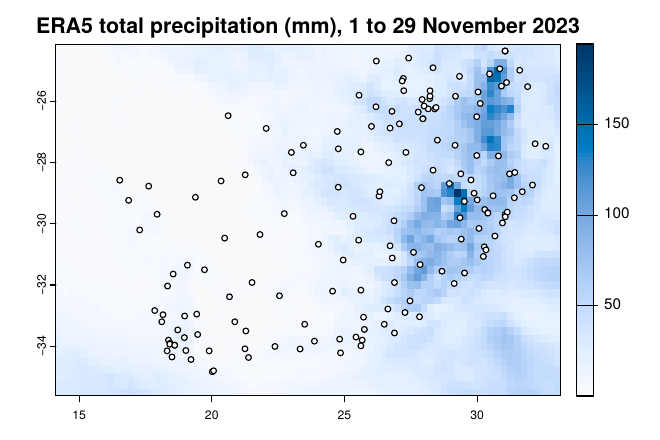
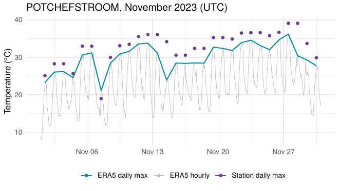
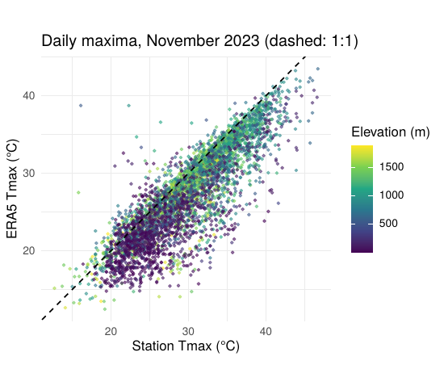

# Manual 05: Make maps and graphs

Script: `code/05_visualise.R`

## 1. Purpose

This script shows the ERA5 data and the GSOD data in maps and graphs.
It also puts the ERA5 values and the station values into one table for the model in script 06.

The script uses two R packages for figures:

- **terra** reads and processes grid data. Its `plot()` function makes quick maps.
- **ggplot2** makes figures from tables. It gives more control over the layout.

## 2. Input and output

| | File | Description |
|---|---|---|
| Input | `data/raw/era5_nov2023/*.nc` | ERA5 hourly data (from script 04). |
| Input | `data/raw/gsod_sa_2023.csv` | GSOD daily data (from script 04). |
| Output | `figures/gsod_missing.pdf` | Missing station days. |
| Output | `figures/era5_tmax_map.pdf` | Map of the mean daily maximum temperature. |
| Output | `figures/era5_diurnal_terra.pdf` | Four maps of one day: the daily cycle. |
| Output | `figures/era5_precip_map.pdf` | Map of the total precipitation. |
| Output | `figures/ts_station_vs_era5.pdf` | One station: ERA5 and station values over the month. |
| Output | `figures/scatter_station_vs_era5.pdf` | All stations: ERA5 values against station values. |
| Output | `data/processed/station_era5_nov2023.csv` | The table for script 06. |

## 3. Key ideas

Read these ideas before you read the code.

**A raster is a stack of maps.**
terra keeps ERA5 data as a `SpatRaster`.
A `SpatRaster` has grid cells (rows and columns) and layers.
Here, one layer is one hour. The temperature raster has 46 rows, 76 columns and 720 layers.

**ERA5 is hourly. GSOD is daily.**
To compare the two, the script changes the hourly ERA5 values to daily values.
It uses UTC days, because GSOD also uses UTC days.

**Some ERA5 values are totals for the hour before the time stamp.**
The precipitation at 00:00 on 2 November fell between 23:00 and 00:00 on 1 November.
The script gives this value to 1 November.

**ERA5 units are not everyday units.**
ERA5 gives temperature in kelvin (K) and precipitation in metres (m).
The script changes K to °C (subtract 273.15) and m to mm (multiply by 1000).

## 4. Procedure

### Step 1: Read the ERA5 data

```r
t2m <- rast(f_inst, subds = "t2m") - 273.15        # K to degrees C
time(t2m) <- nc_times(f_inst)
tp  <- rast(f_accum, subds = "tp") * 1000          # m to mm
time(tp) <- nc_times(f_accum)
```

- `rast()` opens one variable (`subds`) from a NetCDF file.
- `nc_times()` reads the time stamps with the ncdf4 package.

Some versions of terra cannot read the time dimension of new CDS files (`valid_time`).
Then `time(t2m)` gives `NA`. The function `nc_times()` prevents this problem.

### Step 2: Make daily values

```r
day   <- format(time(t2m), "%Y-%m-%d")
tmax  <- tapp(t2m, index = day, fun = max)
tmean <- tapp(t2m, index = day, fun = mean)
```

`tapp()` puts the layers into groups and calculates one value for each group and grid cell.
Here, one group is one UTC day. The result has 30 layers, one for each day.

- `tmax` is the daily maximum temperature (Tmax): the highest of the 24 hourly values.
- `tmean` is the daily mean temperature: the mean of the 24 hourly values.

For precipitation, the script moves each time stamp back by one hour (3600 seconds).
Then it adds the 24 values of each day.
The script removes 31 October and 30 November, because these days do not have 24 values.

### Step 3: Read the station data and find missing days

```r
cal  <- expand.grid(STNID = stn_df$STNID, date = days)
cal$status <- ifelse(paste(cal$STNID, cal$date) %in% have, "Observed", "Missing")
```

The script makes a full calendar: every station and every day of November.
Then it marks each station-day as "Observed" or "Missing".

Two stations can have the same name (for example, two stations called VEREENIGING).
The script uses the station identifier (`STNID`) to keep them apart.

### Step 4: Make the maps

The script makes three maps:

- With ggplot2: `as.data.frame(tmax_month, xy = TRUE)` changes the raster into a table with `x`, `y` and the value. `geom_raster()` draws one square for each grid cell.
- With terra: `plot()` draws the raster directly. The argument `fun` adds the stations to each map.

### Step 5: Get the ERA5 value at each station

```r
pts <- vect(stn_df, geom = c("lon", "lat"), crs = "EPSG:4326")
extract(tmax, pts, method = "simple")      # value of the grid cell that contains the station
extract(tmax, pts, method = "bilinear")    # weighted value from the 4 nearest grid points
```

`vect()` makes points from the station positions.
`extract()` gets the raster value at each point, for each day.

| Method | How it works |
|---|---|
| `simple` (nearest grid cell) | Uses the value of the grid cell that contains the station. |
| `bilinear` | Uses the four nearest grid points. Nearer points get more weight. |

### Step 6: Save the table

The script saves one row for each station and day in `data/processed/station_era5_nov2023.csv`:

| Column | Meaning |
|---|---|
| `STNID`, `NAME`, `lat`, `lon`, `elev` | Station data |
| `date` | UTC day |
| `tmax_stn`, `tmean_stn`, `prcp_stn` | Station values (`NA` on a missing day) |
| `tmax_era5`, `tmean_era5`, `prcp_era5` | ERA5 values of the grid cell that contains the station |
| `tmax_era5_bil` | ERA5 daily maximum with bilinear interpolation |

## 5. Results

### Figure 1: Missing station days



**What the figure shows.** Each row is one station. Each column is one day. Purple is a missing day.

**How to read it.** The stations go from south (bottom) to north (top). A long purple line is a station that did not report for many days.

**What we see.**

- 157 stations have data in November 2023.
- 102 stations have all 30 days.
- 16 stations have more than 5 missing days.
- 294 of the 4 710 station-days (6%) are missing.

### Figure 2: ERA5 mean daily maximum temperature



**What the figure shows.** The mean of the 30 daily maximum temperatures in each grid cell. The white points are the GSOD stations.

**How to read it.** Light colours are hot. Dark colours are cool.

**What we see.**

- The values go from 15.3 °C to 36.8 °C.
- The Northern Cape interior and the Limpopo valley are the hottest areas.
- The ocean and the high Drakensberg (Lesotho) are cool.
- Most stations are in the east and the south-west. The dry west has few stations.

### Figure 3: The daily cycle on 15 November 2023



**What the figure shows.** The 2m temperature at 00:00, 06:00, 12:00 and 18:00 UTC. In SAST, these times are 02:00, 08:00, 14:00 and 20:00.

**How to read it.** All four maps use the same colour scale (`range =`). Thus you can compare the colours between the maps.

**What we see.**

- The land is coolest in the early morning and hottest at 12:00 UTC (14:00 SAST).
- The ocean temperature does not change much during the day.
- This is the reason why we must use UTC days when we compare with GSOD.

### Figure 4: ERA5 total precipitation



**What the figure shows.** The total precipitation from 1 to 29 November 2023 in each grid cell.

**What we see.**

- The west is dry. The east has the most rain, up to 195 mm.
- November is in the summer rainfall season of the eastern half of the country.

### Figure 5: One station over the month



**What the figure shows.** The station POTCHEFSTROOM (683500-99999):

- Grey line: ERA5 hourly temperature in the grid cell of the station.
- Teal line: the ERA5 daily maximum (the highest value of the grey line on each day).
- Purple points: the daily maximum at the station.

**How to read it.** If ERA5 agrees with the station, the purple points are on the teal line.

**What we see.**

- ERA5 follows the warm and cool spells of the station well.
- The ERA5 daily maximum is lower than the station on most days. The mean difference is −2.9 °C.
- There are two reasons. A grid cell value is a mean over about 700 km². Also, the hourly values can miss the peak between two hours.

### Figure 6: All stations, ERA5 against station



**What the figure shows.** One point for each station and day. The colour shows the station elevation.

**How to read it.** The dashed line is the 1:1 line. A point below the line means that ERA5 is lower than the station.

**What we see.**

| Measure | Value | Meaning |
|---|---|---|
| Mean difference (ERA5 − station) | −2.51 °C | ERA5 is lower on average. |
| Root mean square error (RMSE) | 3.97 °C | The typical size of the difference. |
| Correlation | 0.86 | ERA5 and the stations go up and down together. |
| Station-days with ERA5 lower | 84% | |
| RMSE with bilinear interpolation | 3.81 °C | A small improvement over the nearest grid cell. |

The difference changes with elevation:

| Station elevation | Mean difference (ERA5 − station) |
|---|---|
| 0 to 200 m | −3.45 °C |
| 200 to 800 m | −2.75 °C |
| 800 to 1 300 m | −1.97 °C |
| above 1 300 m | −1.79 °C |

The largest differences are at the West Coast and Cape Town stations (for example, Lamberts Bay −9.1 °C).
The grid cells at the coast include ocean. The cold Benguela current makes these grid cells cooler than the land stations.

## 6. Problems

| Problem | Cause | What to do |
|---|---|---|
| `time(t2m)` gives `NA` | terra cannot read `valid_time`. | No action. The script uses `nc_times()`. |
| `factor level ... is duplicated` | Two stations have the same name. | Use the current script. It uses `STNID`. |
| `cannot open file 'data/raw/gsod_sa_2023.csv'` | Script 04 did not run. | Run script 04 first. |
| The ° sign shows as `..` in a PDF | The R session does not use UTF-8. | Use R 4.2 or newer on Windows, or set a UTF-8 locale. |

## 7. Terms

| Term | Meaning |
|---|---|
| Bilinear interpolation | A weighted mean of the four nearest grid points. |
| Daily maximum temperature (Tmax) | The highest temperature of one UTC day. |
| Layer | One map in a raster. Here, one hour or one day. |
| RMSE | Root mean square error. The square root of the mean squared difference. |
| `SpatRaster` | The terra object for grid data. |
