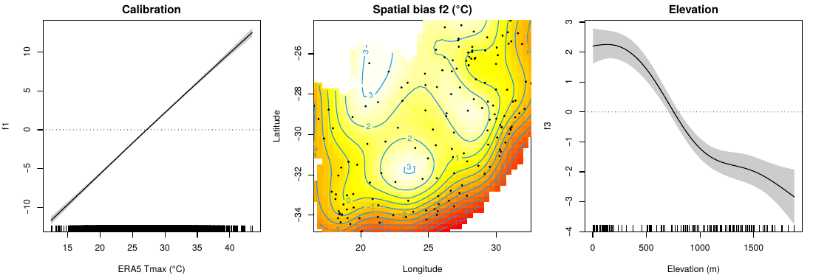
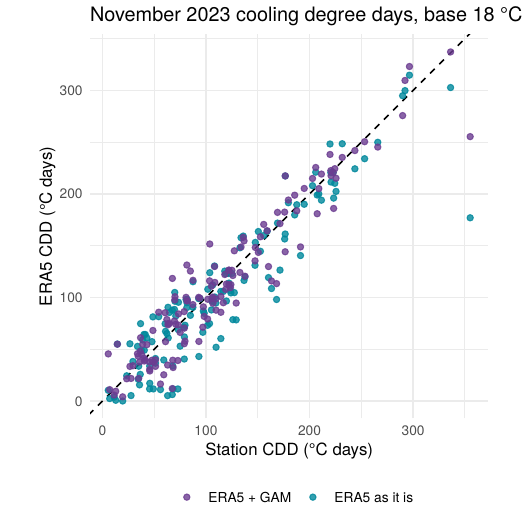

# Manual 06: Fit a model that compares ERA5 with the stations

Script: `code/06_gam_model.R`

## 1. Purpose

Many places have no weather station, but ERA5 has a value for every grid cell.
This script asks one question:

> Can ERA5, after a correction, give the temperature at a place without a station?

The script fits a generalised additive model (GAM).
Then it tests the model on stations that the model did not see.
At the end, it calculates a financial quantity: cooling degree days.

## 2. Input and output

| | File | Description |
|---|---|---|
| Input | `data/processed/station_era5_nov2023.csv` | The table from script 05. |
| Output | `figures/gam_smooths.pdf` | The three parts of the model. |
| Output | `figures/cdd_station_vs_era5.pdf` | Cooling degree days: station against ERA5. |

The script also writes numbers in the R console: the model summary, the model check and the validation results.

## 3. Key ideas

### The model in words

The station temperature is equal to:

- a calibrated ERA5 value,
- plus a correction for the place (position on the map),
- plus a correction for the station elevation,
- plus an error.

### The model as an equation

For station $i$ on day $t$:

$$
T^{\text{stn}}_{i,t} = \beta_0 + f_1\left(T^{\text{ERA5}}_{i,t}\right) + f_2(\text{lon}_i, \text{lat}_i) + f_3(\text{elev}_i) + \varepsilon_{i,t},
\qquad \varepsilon_{i,t} = \rho\,\varepsilon_{i,t-1} + u_{i,t}
$$

| Part | Name | What it does |
|---|---|---|
| $\beta_0$ | Intercept | The mean level. |
| $f_1$ | Calibration | Changes the ERA5 value to the station scale. |
| $f_2$ | Spatial bias | A smooth surface over the map. It shows where ERA5 is too cool or too warm. |
| $f_3$ | Elevation | A grid cell is a mean over hills and valleys. This part corrects for the station height. |
| $\varepsilon$, $\rho$ | AR(1) error | The error of one day is related to the error of the day before. $\rho$ is this correlation. |

### What is a GAM?

A linear model uses straight lines.
A GAM uses smooth curves.
The data gives the shape of each curve.

Each curve is a sum of simple basis functions. The argument `k` sets the maximum number of basis functions.
A penalty prevents curves that are too wavy. The method REML chooses the size of this penalty.

The result for each curve is the **effective degrees of freedom (edf)**:

- edf = 1 means a straight line.
- A larger edf means a more curved line.

### Why the AR(1) error?

Weather changes slowly. If a station is warmer than the model today, it is probably warmer tomorrow also.
A model that ignores this correlation gives standard errors that are too small.
The AR(1) error adds this correlation to the model.

### Why test on other stations?

A model always fits its own data well.
The real test is a station that the model did not see.
This is the situation of a place without a station.

## 4. Procedure

### Step 1: Prepare the data

```r
fit_dat <- dat[!is.na(dat$tmax_stn) & !is.na(dat$tmax_era5) & !is.na(dat$elev), ]
fit_dat$start <- c(TRUE, fit_dat$STNID[-1] != fit_dat$STNID[-nrow(fit_dat)] |
                         diff(fit_dat$date) != 1)
```

- The script keeps the station-days that have a station value and an ERA5 value.
- The column `start` is `TRUE` on the first day of a station and after each missing day. The AR(1) error starts again at these rows.

### Step 2: Fit a first model and estimate ρ

```r
f   <- tmax_stn ~ s(tmax_era5) + s(lon, lat, k = 30) + s(elev, k = 5)
m0  <- gam(f, data = fit_dat, method = "REML")
rho <- cor(...)   # lag-1 correlation of the residuals, inside each station
```

- `s()` makes a smooth curve. `s(lon, lat)` makes a smooth surface over the map.
- `m0` has no AR(1) error.
- The script calculates the correlation between the residual of one day and the residual of the day before. It uses pairs from the same station only. This value is ρ.

### Step 3: Fit the final model

```r
m1 <- bam(f, data = fit_dat, rho = rho, AR.start = fit_dat$start)
summary(m1)
gam.check(m1)
```

`bam()` fits the same model as `gam()`, but it can include the AR(1) error.

### Step 4: Do a validation with stations left out

```r
group <- setNames(sample(rep(1:5, length.out = length(ids))), ids)
```

The script puts the stations into five groups at random. Then, for each group:

1. Fit the model without the stations of the group.
2. Predict the daily maximum at the stations of the group.
3. Calculate the RMSE of the prediction.
4. Calculate the RMSE of ERA5 without a correction.

### Step 5: Calculate cooling degree days

```r
cdd <- function(x) sum(pmax(0, x - 18))
```

The script fits the same model for the daily mean temperature.
Then it calculates the cooling degree days of November for each station, in three ways:

1. From the station.
2. From ERA5 without a correction.
3. From ERA5 with the GAM correction.

The script uses only the days with a station value. Thus all three use the same days.
It uses only stations with 25 or more days.

## 5. Results

### The model summary

| Part | edf | Meaning |
|---|---|---|
| s(tmax_era5) | 1.7 | Almost a straight line. |
| s(lon, lat) | 26.7 | A surface with much detail. The bias changes over the country. |
| s(elev) | 3.7 | A curve. |

- The model uses 4 416 station-days from 157 stations.
- The deviance explained is 77.9%. The model explains about 78% of the variation in the station values.
- ρ = 0.30. The errors of two consecutive days have a correlation of 0.30.

**The model check (`gam.check`).**
The k-index is less than 1 for the spatial and elevation parts.
Usually, this tells you to increase `k`. We tried k = 60. The results did not change much.
The low k-index comes from the stations: days of the same station are similar.
The smooth curves cannot see these local effects.

### Figure 1: The three parts of the model



**How to read the figure.**
Each part is centred on zero. A value above zero means "warmer than the average prediction".
The grey band is the 95% confidence band.
The short lines on the horizontal axis show where the data is.

**Left: Calibration ($f_1$).**
The line is almost straight.
If ERA5 goes up by 1 °C, the predicted station value goes up by about 0.8 °C.

**Middle: Spatial bias ($f_2$).**
Light colours are positive. Red colours are negative. The blue lines are contours in °C.

- The interior (Highveld and Karoo) is about +2 to +3 °C.
- The south coast and the east coast are negative, down to about −3 °C.
- Thus ERA5 is too cool most in the interior after the other corrections.

**Right: Elevation ($f_3$).**
The correction is about +2 °C at sea level and about −2.8 °C at 1 900 m.
Low stations are warmer than the grid cell value suggests.
Many low stations are at the coast, where the grid cell includes cool ocean.

### Validation with stations left out

| Group | Stations | RMSE of ERA5 (°C) | RMSE of the GAM (°C) |
|---|---|---|---|
| 1 | 32 | 3.84 | 3.05 |
| 2 | 32 | 4.79 | 3.19 |
| 3 | 31 | 3.55 | 2.82 |
| 4 | 31 | 3.66 | 2.71 |
| 5 | 31 | 3.80 | 2.73 |
| **Mean** | | **3.93** | **2.90** |

The GAM is better in all five groups.
At a place without a station, the typical error goes down from 3.9 °C to 2.9 °C.

### Figure 2: Cooling degree days



**What is a cooling degree day (CDD)?**
For one day, CDD is the number of degrees by which the mean temperature is above 18 °C.
A day with a mean of 25 °C gives 7 CDD. A day with a mean of 15 °C gives 0 CDD.

$$
\text{CDD}_{\text{month}} = \sum_{\text{days}} \max\left(0,\ \overline{T}_{\text{day}} - 18\right)
$$

Energy companies use CDD to estimate the demand for air conditioning.
Some weather insurance contracts and weather derivatives pay out on a CDD index.

**What the figure shows.** One point for each station. Teal points use ERA5 without a correction. Purple points use ERA5 with the GAM correction.

**How to read it.** A point on the dashed line means that the ERA5 index agrees with the station index.

**What we see.**

| Measure | ERA5 without correction | ERA5 with GAM |
|---|---|---|
| Mean difference from the station (CDD) | −7.3 | −1.4 |
| Mean absolute difference from the station (CDD) | 20.6 | 16.4 |

- 141 stations have 25 or more days. Their mean November CDD is 114.
- Without a correction, ERA5 gives too few CDD: ERA5 is too cool.
- The correction removes most of this bias.

**Why this is important: basis risk.**
Suppose that a contract pays on an index from ERA5, but the loss happens at one farm or one building.
The difference between the index and the local value is the **basis risk**.
The figure shows this difference for 141 places.

## 6. Limits of this example

- The data covers one month only. The model cannot learn the seasonal change of the bias.
- The CDD correction uses the same stations as the fit. The real improvement at a new place is probably smaller. The validation in Step 4 gives a fair test for the daily maximum.
- GSOD values can have errors. The model does not remove bad station values.
- The model does not know the elevation of each ERA5 grid cell. With the ERA5 surface geopotential, you can calculate this elevation and use the height difference.

## 7. Problems

| Problem | Cause | What to do |
|---|---|---|
| `object 'start' not found` or `object 'train' not found` | `AR.start` inside a function must use the column name. | Use `AR.start = start`, as in the script. |
| The results change a little between runs | The station groups are random. | `set.seed(1)` makes the groups the same each time. |
| `cannot open file 'data/processed/station_era5_nov2023.csv'` | Script 05 did not run. | Run script 05 first. |

## 8. Terms

| Term | Meaning |
|---|---|
| AR(1) | First-order autoregressive. The error of one day depends on the error of the day before. |
| Basis risk | The difference between an index value and the real local value. |
| Cooling degree days (CDD) | The sum over days of the mean temperature above 18 °C. |
| Deviance explained | The part of the variation that the model explains (similar to R²). |
| edf | Effective degrees of freedom. 1 means a straight line. |
| GAM | Generalised additive model. A regression model with smooth curves. |
| REML | Restricted maximum likelihood. The method that chooses how smooth each curve is. |
| Residual | The observed value minus the predicted value. |
| Validation | A test of the model on data that the model did not see. |
